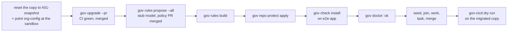

# Testing the adopter path

**Audience:** internal testers and contributors. Adopters do not need this page —
theirs is one command, and this is how we make sure it stays that way.

Everything an adopter hits before `gov` exists is invisible from a developer's
machine, where Node, git, `gh` and a signed-in token are all long since true.
Every defect this path has produced was found by running it somewhere those things
were **not** true. So: throwaway containers, one per scenario.

---

## First decide which question you are asking

There are four routes on this page and they answer different questions. Picking the
wrong one wastes a walk — or worse, passes while testing the wrong binary.

| Your change is… | Walk | Because |
|---|---|---|
| **already released** | the **live site** — `curl -fsSL https://gov.svayamtech.com/install.sh -o install.sh && bash install.sh` | It is the artefact an adopter receives, and it exercises the site and the fetch-then-run form too. No mount, no `GOV_PKG`. |
| **deployed to dev** | **`gov-dev.svayamtech.com`** — see *Walk what dev has deployed* below | The dev-first loop. Installer from the `dev` ref, client from the dev registry at `@dev`. Not for template changes. |
| **only in your working tree** | the **local site** — see *Walk your working tree* below | Your installer and your client, served on your machine. Nothing pushed, nothing deployed. Start here. |
| **no gov-cicd to hand** | the **tarball recipe** below (`GOV_PKG`) | The same test by hand: mount a packed client and your `install.sh` into the container yourself. |

Check before assuming: `npm view @svayam-opensource/gov version` against the commit
you are testing. If your fix is in that version, use the site.

### Walk your working tree — before anything goes anywhere

The loop to use first: fix it locally, then send it to dev. **Commit** your change (the deploy judges drift
on `HEAD`, so an uncommitted edit reads as `no-op` — pushing is not needed), then from the **project
directory** (for `local`, the catalog is your working tree):

```bash
gov-cicd deploy gov-install --env local
```

> **Check your gov-cicd first if you have unpushed commits.** Before 910-GOV-CICD#289, a local deploy
> run while your checkout was *ahead* of origin **force-reset your branch to origin**, silently orphaning
> the unpushed commits (recoverable only from `git reflog`). With an older gov-cicd, **push before you
> deploy local** — or check `git reflog` afterwards for `branch: Reset to origin/…`.

gov-work deploys first, then the site, which comes up on `127.0.0.1:4002` carrying a fourth build,
`local`, made from your worktree: its `install.sh`, and a client packed from its `publish/actions/ts` and
served at `/gov.tgz`. Walk it from a container:

```bash
docker run --rm -it rockylinux:9 bash
# root prep as in the base recipe, then as tester:
curl -fsSL http://host.docker.internal:4002/install.sh -o install.sh && bash install.sh
```

**The tell that you are walking your own build**, since the client's version string is the same as the
release it will become: the installer prints
`Installing the governance client — http://host.docker.internal:4002/gov.tgz`. Anything else, and it is not.

A client-only change counts: gov-install's catalog entry lists `publish/actions/ts` under `also_local`, so
locally — and only locally — the site rebuilds when the client does.

It never leaves your machine. Only a local build is given `GOV_LOCAL=1`, a local image is never pushed,
and the `local` build answers only to `localhost`, `127.0.0.1` and `host.docker.internal`. Every other host,
as ever, gets a 404.

`host.docker.internal` reaches the host out of the box on Docker Desktop. On native Linux docker, add
`--add-host=host.docker.internal:host-gateway` to the walker, and note the site is bound to loopback.
`install.ps1` gets the same treatment: the local site's Windows installer installs your client from
`/gov.tgz`, and every shared site pins its own env's package and registry, exactly as `install.sh` does.

### Walk what `dev` has deployed

Once a change is deployed to dev, walk **`gov-dev.svayamtech.com`** in a container —
the same fetch-then-run command, the dev host:

```bash
curl -fsSL https://gov-dev.svayamtech.com/install.sh -o install.sh && bash install.sh
```

That is the dev-first loop: change lands in `dev` → deploy → walk here → promote.
It installs `install.sh` from the `dev` ref and the client from the dev registry at
dist-tag `@dev` (`⟨semver⟩-dev.g⟨sha7⟩`). **Check the version it reports** — if it
says a clean release like `1.2.3`, the dev pin is wrong and you are walking the code
your change replaced.

Two things it does **not** give you, so do not rely on it for them:

- **Governance template content.** Founding an org (answer **A**) runs
  `gh repo create --template`, which always copies the framework's **`main`**. A dev
  walk exercises a dev *client* against *released* templates. A template change cannot
  be walked from here.
- **A developer machine.** A fresh container has no `~/.npmrc`. The installer had a
  bug that only bit where `@svayam-opensource:registry` was mapped — a scope mapping
  silently outranks `--registry` — and every container walk passed straight over it.
  Anything that depends on the tester's own npm config needs a test that plants that
  config first.

---

## The one thing testers do that adopters don't: `GOV_PKG`

`install.sh` installs the **published** package:

```bash
npm i -g @svayam-opensource/gov
```

Which is what you want it to do — and useless for testing an unreleased change,
because the published version does not contain it. `GOV_PKG` overrides **what** is
installed and nothing else:

```bash
export GOV_PKG=/tmp/gov.tgz                     # a local build
export GOV_PKG='@svayam-opensource/gov@next'    # a prerelease dist-tag
```

The Node download, the home-directory install, the PATH edit and the hand-off to
`gov doctor --fix` are identical either way. That is the point: you are testing the
route an adopter walks, carrying a different parcel.

> **Never hardcode it into `install.sh`.** A script that installs from
> `/tmp/gov.tgz` fails on every real machine, and would fail *late* — after the
> Node install has already succeeded.

Build the parcel first:

```bash
cd publish/actions/ts
npm run build && npm pack --pack-destination ~/scratch
# → ~/scratch/svayam-opensource-gov-<version>.tgz
```

Re-pack after **every** source change. A stale tarball is the most common way to
spend twenty minutes debugging a fix you already made.

---

## The base recipe

```bash
docker run --rm -it \
  -v ~/scratch/svayam-opensource-gov-1.2.2.tgz:/tmp/gov.tgz:ro \
  rockylinux:9 bash
```

Then, **as root**, make the container resemble a real machine — a user who is not
root, with `sudo` available:

```bash
dnf install -y sudo
useradd -m tester
echo 'tester ALL=(ALL) NOPASSWD: ALL' > /etc/sudoers.d/tester
su - tester
```

Do **not** `dnf install curl tar`. They are already there — `curl-minimal`
provides curl, and asking for the full `curl` package *conflicts* with it. That is
itself a finding worth remembering: our documentation must say "check that curl
works", never "install curl".

Then, as `tester`, the whole adopter step:

```bash
export GOV_PKG=/tmp/gov.tgz
curl -fsSL https://raw.githubusercontent.com/svayam-opensource/governed-agentic-dev-framework/main/install.sh -o install.sh \
  && bash install.sh
```

Testing an unpushed `install.sh`? Mount it rather than fetching one:
`-v "$PWD/install.sh":/tmp/install.sh:ro`, then `bash /tmp/install.sh`. (Swapping the
branch name into the URL works too, but only after you push.) Or skip all of this and
use the local site above, which does both for you.

It will show you what is missing, ask once, and — if you say yes — install git,
install `gh`, and walk you through signing in to GitHub.

### Then, two more steps

```bash
source ~/.bashrc     # this shell predates the install; it has never heard of gov
gov list
```

`source` is not optional and not superstition: `install.sh` appended the PATH entry
to a file your **already-running** shell read minutes ago. Skip it and the next
thing you type is `gov: command not found`, which looks like a failed install and
is not one.

`gov list` is the shortest way to reach the **first-run role question** (A/B/C).
Answer **C** first — it only prints.

---

## Scenarios worth running

Each is one line different from the recipe above, and each has broken something
at least once.

| # | Scenario | How | What must happen |
|---|---|---|---|
| 1 | **Nothing installed** | `rockylinux:9` as above | Node downloaded to `~/.local/share/gov`, gov installed, `--fix` offers git + gh |
| 2 | **An old Node is present** | `dnf install -y nodejs` first (RHEL 9 ships 16) | Node 24 installed *alongside*; the system's Node untouched; no `dnf` conflict |
| 3 | **Run twice** | run the same command again | "already present", nothing re-downloaded, no duplicate PATH entry |
| 4 | **No sudo rights** | omit the `sudoers.d` line | One sentence explaining that installing git/gh needs an administrator, then clean skips — never raw `sudo:` errors |
| 5 | **No sudo at all** | omit `dnf install -y sudo` too | Same, phrased for a machine with no `sudo` |
| 6 | **No terminal** | `bash < install.sh` instead of `\| bash` | Reports, names `gov doctor --fix`, exits — must not hang |
| 7 | **Unattended** | `gov doctor --fix --yes` | Never reaches `gh auth login`; names it as the human's remaining job |
| 8 | **First run** | `gov list` | The A/B/C role question. **C** is the safe one to explore — it only prints |

### Other distributions

Swap the image and the root-side prep. Everything else is identical.

| Distribution | Image | Root prep |
|---|---|---|
| Rocky / RHEL | `rockylinux:9` | `dnf install -y sudo` |
| Fedora | `fedora:41` | `dnf install -y sudo` |
| Ubuntu | `ubuntu:24.04` | `apt-get update && apt-get install -y curl sudo ca-certificates` |
| Debian | `debian:12` | `apt-get update && apt-get install -y curl sudo ca-certificates` |

They differ in ways that matter and have each caught something: Fedora carries
`gh` in its own repositories while Rocky does not, and dnf5 renamed the command
that adds one.

### macOS, without disturbing your own machine

```bash
T=$(mktemp -d)
env -i HOME=$T SHELL=/bin/zsh PATH=/usr/bin:/bin:/usr/sbin:/sbin \
  GOV_PKG=~/scratch/svayam-opensource-gov-1.2.2.tgz \
  bash ./install.sh
rm -rf $T
```

`env -i` and the stripped `PATH` are load-bearing: without them the script finds
the Node you already have, skips the install, and tests nothing. `HOME=$T` keeps
the PATH edit out of your real `~/.zshrc`.

### Windows

Not testable locally — Docker on a macOS or Linux host cannot run Windows
containers, and `pwsh` on Linux has none of the three things `install.ps1` is made
of (`LOCALAPPDATA`, `PROCESSOR_ARCHITECTURE`, a user-scoped `PATH`).

The `bootstrap` job in `.github/workflows/node-ci.yml` is the test bed: it runs on
`windows-latest` with `setup-node` deliberately absent and the runner's own Node
stripped from `PATH`. **Open a PR to run it.** A push to a branch will not — the
workflow's `push` trigger is limited to `main` and `dev`.

---

## The automated journey scenarios

The walks above are by hand. The hermetic **journey** tier (`publish/actions/ts/e2e/journey.d/`, how it works:
`e2e/README-journey.md`) drives the real gov in a pty against stub `gh`/`git` and agent doubles. CI's `journey`
job in `adopter-e2e.yml` runs **every** scenario on rocky, debian and fedora — there is no sharding, so a new file
in `journey.d/` is in the matrix the moment it lands. Run one locally with `npm run test:journey <number>`.

| # | Scenario |
|---|---|
| 30 | adopter founds an org, IBM Bob as the default agent |
| 32 | adopter founds an org that uses no AI agents (structure-only) |
| 40 | joiner, org default agent, nothing installed |
| 45 | the closing checklist follows the path actually walked |
| 47 | joiner, organization on an older framework layout |
| 48 | **adopter whose template is older than gov** — the template is `git archive` of this repository at the newest `gov-work-*` release tag on an older layout; the new repository must come out in the layout gov seeds (`framework/`, `policies/`, nothing else at the root). Fails if `d087f8e` is reverted. Needs the release tags: the CI job checks out with full history, and locally `git fetch --tags`. |
| 50 | adopter, org already governed → the pivot to joining |
| 55 | adopter declines the pivot |
| 60 | agent install — IBM Bob |
| 62 | the work flow installs and signs in an agent |
| 64 | the menu installs and signs in an agent |
| 66 | the closing offer installs and signs in an agent |
| 68 | a first-run licence gate, cleared in the same terminal |
| 69 | a failed retry says the reason gov knows |
| 70 | an expired agent trial is said plainly, another approved agent is offered |
| 72 | the menu with a dead active org |
| 74 | knowledge search reads the workspace |
| 76 | the work picker |

---

## What to look at, beyond pass or fail

The scenarios above tell you whether it worked. These questions tell you whether
it is any good, and they are the ones worth writing up:

- **Did anything ask you something you could not answer?** That was the original
  defect: a clone-URL prompt only a joiner could answer.
- **Did an error explain itself, or hand you the tool's own words?** `sudo: a
  password is required` and `No such command: config-manager` are both true and
  both useless to someone who did not go looking for them.
- **Did you have to leave the terminal to find out what to do next?**
- **Did anything need administrator rights that shouldn't have?** Installing gov
  needs none. Only installing git or `gh` does.

Record findings as you go. `#186`'s were logged one at a time while testing, and
seven of them turned out to be real.

---

## The human walk tier — the timed 10-minute walk

The tiers above are scripts. The release gate is a **person** who has never seen gov,
on a fresh machine, timed from opening the README to their agent posting its context
manifest — **≤ 10:00** (account creation excluded, every sign-in included). Each step
has a budget:

| # | Step | macOS / Linux | Windows | ends when |
|---|---|---|---|---|
| 1 | Door: README → one command | 0:30 | 0:45 | install command running |
| 2 | Install: Node 24 + gov | 1:30 | 1:00 | `gov` runs in this shell |
| 3 | Dependencies + GitHub sign-in | 1:30 | 2:00 | step 6 of the checklist ticked |
| 4 | Adopt interview + repo created + seeded | 2:30 | 2:30 | "what now exists" printed |
| 5 | Agent install + sign-in | 1:30 | 1:30 | agent installed **and runnable** |
| 6 | Review offer → seed → launch | 1:30 | 1:30 | agent posts its context manifest |

**The log is the stopwatch.** gov writes a phase marker into its run log at every
checklist banner (`phase step-<n>`, `phase step-<n>-done`) and at each walk boundary
(`phase first-run`, `adopt-done`, `review-offer`, `agent-ready`, `agent-launch`).
`scripts/walk-times.mjs` cuts the six steps from those lines. Three marks are the
observer's, because gov is not running at them: README opened, install command
running, manifest posted.

```bash
cd publish/actions/ts
node scripts/walk-times.mjs --os linux \
  --start 2026-10-12T10:00:00Z --install-at 2026-10-12T10:00:25Z --manifest-at 2026-10-12T10:08:30Z \
  --markdown ~/.gov/logs/2026-10-12 ~/.gov/<slug>/projects/preferences/<login>/state/logs/2026-10-12
```

It prints the walk record's step table with each step over or under its budget, and
says where each end came from. Without the observer's marks it still cuts steps 3–6
and says the result is partial. `--json` gives the same for a script.

The walk kit — what the walker is told (only the README link), the observer's
checklist, the record template and the machine setup — lives with the project that
runs the walks: `projects/PRJ-121-doc-update-issue-116/knowledge/walks/` in the
workspace repo (`WALK-SCRIPT.md`, `TEMPLATE.md`, `MACHINES.md`).

---

## What green means — adopter-e2e, computed

`adopter-e2e` (`.github/workflows/adopter-e2e.yml`) runs these tiers: `smoke` (hermetic), `journey`
(pty, three distros), `os-tier` (bare machines), `live` (the adopter and rule-model journeys
against real GitHub in the sandbox org), and — on a manual dispatch only — `bridge` (below). A run is **green** only when all of this is true, and
nobody decides it by reading a summary line:

- the run concluded `success`, and **every job** concluded `success` — a skipped job is not a pass;
- **no step was skipped** and **no assertion was skipped** — a journey that passed with a skipped
  assertion is `incomplete`;
- it is the **first attempt** — a re-run is a retry, and a retry is not evidence.

The release measure (PRJ-121 I05.1) is **three such runs in a row, all manual dispatches, on the same
commit**. A new commit restarts the count at 0. `green-streak.sh` computes it:

```bash
cd publish/actions/ts
gh workflow run adopter-e2e.yml --ref <branch>      # one at a time; wait for each to finish
bash e2e/green-streak.sh <branch> 3                 # GREEN_STREAK_REPO=owner/repo for a fork
```

It walks the branch's runs newest first, reads every run's jobs, steps and annotations, and prints
one line per run — `OK`, or `BREAK:` and why (`event push`, `different commit`, `attempt 2`,
`job "…" failure`, `step skipped: …`, `annotation: rule-model journey: skipped (f) …`) — then
`STREAK k/3`. It exits 0 only at 3/3. Paste its output, with the run ids, into the PR.

### Which secrets each tier needs, and when a skip is allowed

| Tier | Needs | When something is missing |
|---|---|---|
| `smoke`, `journey`, `os-tier` | nothing | — |
| `live` — adopter journey | secret `TESTBED_BOT_PAT` (classic: `repo`, `workflow`, `project`, `read:org`, `delete_repo`; or fine-grained on **all** repositories of the sandbox org — a selected-repositories token cannot read the repos a run creates), variable `TESTBED_SANDBOX_ORG` | **fails** on a manual dispatch, a PR into `dev`/`main`, a push to `dev`/`main`; **skips visibly** (notice + run summary) on a feature-branch push |
| `live` — rule-model journey, assertion (f) | secrets `GOV_E2E_APP_CLIENT_ID`, `GOV_E2E_APP_PRIVATE_KEY` | the same: the guard names them up front on a strict run; elsewhere (f) is skipped, named, and the journey reports `incomplete` |
| `live` — real model | secret `GEMINI_API_KEY`, only when dispatched with `real_model` | fails that dispatch |

The decision is made by `publish/actions/ts/e2e/live-guard.sh` (the workflow's first `live` step), and
the verdict by `e2e/live-verdict.sh` (its last), which lists every journey and every skipped assertion
in the run summary. Both are tested with the secrets unset (`test/e2e/live-gate.test.ts`), so proving
the guard never needs the repository's real secrets removed. Token scopes are in
`publish/actions/ts/e2e/README.md`.

### The bridge tier — rehearsing the Svayamtech migration

The bridge pre-release (`2.0.0-next.B`, PRJ-121 intent 01) carries Svayamtech's governance repo from its 1.0
layout to the 2.0 layout in one `gov upgrade --pr`. Before that runs on the real repository it is rehearsed on a
copy: `svayam-e2e/svm-prj-work-rehearsal`, private, one commit with no history, secret-scanned before it was
pushed (H01). H01 tags that commit `h01-snapshot`. The copy is deleted once both real runs are done (H05).

`publish/actions/ts/e2e/bridge-journey.sh` is the rehearsal (spec 01 §4.3 step 2) as a script:



- **Every run starts from the same tree.** It moves the copy's default branch back to `h01-snapshot`, closes open
  pull requests and deletes the other branches. It then adds one commit that points `org-config.yaml` at the
  sandbox org, never at Svayamtech, and makes CI install the gov under test.
- **It refuses any other target**: a repository outside the sandbox org, a sandbox repository whose name does not
  contain `rehearsal`, or the real org itself. It checks this before it reads a token.
- **The copy is kept** after the run, so the Policy Owner can review the rehearsal PR (§4.3 step 4). What the run
  created beside it — the board, the issue, the branch on `e2e-app` — is deleted.
- **"CI green"** means every check run on the PR passed, except the checks that wait for an authorized approval
  (`approver-check`, `GOV-FRM-455 · pull_request`). The bot is not the copy's approver.

Run it from the workflow: `gh workflow run adopter-e2e.yml --ref <branch> -f bridge=true`. Without
`bridge=true`, the `bridge` job runs the script's hermetic dry run (`--dry-run`: every call is printed and none is
made). The job therefore never shows as skipped on a dispatch, and the green streak still counts the run. Its last
step, `live-verdict.sh` with `JOURNEYS=bridge:<outcome>`, gives the verdict under the same rules as the `live` job:
a skipped step (for example, no `GOV_CICD_PACKAGE` for the gov-cicd step) makes the rehearsal `incomplete`, and
that fails the dispatch. `test/e2e/bridge-journey-dry.test.ts` checks the dry run, the refusals, the job's shape
and its verdict without a token.

| Bridge tier needs | |
|---|---|
| the copy `svayam-e2e/svm-prj-work-rehearsal` with tag `h01-snapshot` | H01 |
| secret `TESTBED_BOT_PAT`, variable `TESTBED_SANDBOX_ORG` | as for `live` |
| the sandbox code repo `svayam-e2e/e2e-app` (`BRIDGE_APP_REPO` to change) | step 5 is skipped (incomplete) without it |
| variable `GOV_CICD_PACKAGE` (the gov-cicd package or tarball) | the gov-cicd step is skipped (incomplete) without it |

The rehearsal is done when two runs in a row are clean (H02), on dev builds, and once more on the cut bridge
(H03).

**Board poll and token probe.** After adding its issue to the board, the adopter journey prints
`probe:` lines (`e2e/token-probe.sh`): the token's kind, and whether it can read the new repo, the
issue and the board item. Its poll then tells two failures apart: items whose content is null — the
token cannot read the issue; it dies at once, `token cannot read <repo> — <kind>` — and no items yet,
which is GitHub's index latency; it waits up to 3 minutes and says on which poll the item appeared.

---

## What a container cannot test, and must not be marked failed for

Some steps cannot pass in here no matter how correct gov is. Recognise them, or you
will file gov defects against the test rig — three walks were lost that way.

**Any browser-based sign-in.** The agent starts a loopback listener *inside* the
container and prints a URL for a browser that is *outside* it, so the callback never
arrives. IBM Bob is the one you will hit first: it listens on `127.0.0.1:<random>`
and waits. Nothing is wrong with Bob or with gov.

Two ways through, and pick deliberately:

```bash
# in the container — skip the browser entirely
export BOB_API_KEY=...        # then let gov's key route take it
```

or run that one step on the host, where a browser exists.

This is also why **#213** matters and why `98-desktop-hint.sh` asserts it: on a machine
with no desktop, gov must offer the paste-a-key route *first* and must never withhold the
browser route. If you see gov push you at a browser in here, that **is** a gov defect —
the distinction is between gov offering an impossible route first (a defect) and the
route itself being impossible in a container (the rig).

**Anything needing a real desktop.** `98-desktop-hint.sh` runs an actual `Xvfb` when the
image has one and says `SKIPPED` when it does not. A skipped assertion is not a pass;
if the image lacks `Xvfb`, that branch was not exercised here at all.

---

## Resetting

Containers are `--rm`, so scenario 1 is a fresh `docker run`. To reset in place
without leaving the container:

```bash
rm -rf ~/.local/share/gov ~/.npm-global ~/.config/gov ~/.gov
sed -i '/added by the gov installer/,+1d' ~/.bashrc
exec bash -l
```
