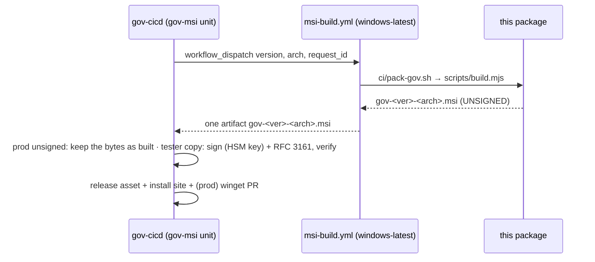

# packages/msi — gov for Windows, as a per-user MSI

For maintainers. Adopters read `docs/installing.md`.

The MSI is the Windows door (PRJ-121 spec 04 §4.2–§4.5). It installs gov and a private Node 24 for the current
user. It needs no elevation and makes no machine-wide change.

```
%LOCALAPPDATA%\Programs\gov\
    node\   nodejs.org's Node 24 zip for the arch, checked against SHASUMS256.txt   (never on PATH)
    app\    the gov npm package (npm pack) + production node_modules (npm ci)
    bin\    gov.cmd                                                               (the ONLY PATH entry)
```

## Who builds, signs and publishes it



- **Build** (`scripts/build.mjs`) runs on Windows with WiX v4 (`ci/setup-wix.ps1`). gov-cicd starts it through
  `.github/workflows/msi-build.yml`. The interface is described in gov-cicd's `docs/msi-packaging.md`.
- **Sign** is never done here for a release. `scripts/sign.mjs --signer "<command with {file}>"` runs the
  caller's signer. gov-cicd passes its HSM-backed command. CI passes `ci/sign-test.ps1`, which creates a
  throwaway certificate inside the job.
- **Unsigned until a production certificate exists** (Policy Owner ruling P1 REVISED, 2026-10-14). gov-cicd's
  catalog sets `msi.signing.prod: unsigned`, so prod ships the bytes this package built, with no signature. A
  test-signed copy is still made at uat for named testers, and that copy is never released. A directly
  downloaded `.msi` shows "Unknown publisher", so winget is the Windows door. Revisit before bank pilots.
- **winget** (`scripts/winget.mjs`) renders the `Svayam.Gov` manifests from `winget/` for the released MSIs.
  winget checks `InstallerSha256` and needs no signature, so the listing is the same for signed and unsigned MSIs.
  gov-cicd's prod promote runs it and opens the `microsoft/winget-pkgs` PR. Only plain `x.y.z` versions are listed.

## Build it yourself (Windows)

```powershell
pwsh packages/msi/ci/setup-wix.ps1
bash packages/msi/ci/pack-gov.sh "" "$env:TEMP\pkg"      # prints the .tgz path, then its version
node packages/msi/scripts/build.mjs --version 1.2.3 --arch x64 --out "$env:TEMP\msi" --gov-tgz <tgz>
```

`--stage-only` stops before WiX, so it runs on any OS and shows the staged tree.

## Design notes

- **No `gov.ps1`.** PowerShell would pick `gov.ps1` ahead of `gov.cmd` and then refuse it under the default
  `Restricted` execution policy (the familiar `npm.ps1 cannot be loaded`). `gov.cmd` runs from cmd, PowerShell
  and Windows Terminal. The Pester test checks `gov --version` under `Restricted`.
- **The launcher contract** (T11): `bin\gov.cmd` sets `GOV_BIN_DIR` to `bin\`, puts `node\` first on PATH and sets
  `NPM_CONFIG_PREFIX` to `node\`. All three apply to gov's own process only. Agents that gov installs land in `node\`.
  gov then writes a `bin\<agent>.cmd` shim, so the agent works in a new terminal.
- **The file list** is generated from the staged tree (`lib/wxs.mjs`). It has one component per directory, keyed by
  an HKCU value, with GUIDs derived from the path. A per-user package needs this shape (ICE38/ICE64).
- **Upgrades:** a fixed `UpgradeCode` + `MajorUpgrade`. **Never change the UpgradeCode.**
- **Uninstall** removes `node\ app\ bin\`, including the agents and shims gov added after install, and the PATH entry.
  It leaves `~/.gov` alone. During a MajorUpgrade those extra files are kept.

## Tests

| Where | What |
|---|---|
| `npm test` here (any OS) | checksum mismatch fails the build; staged layout; `bin\` holds only the launcher; launcher contract; WiX fragment shape; signer quoting; winget manifests |
| `test/install.Tests.ps1` (Pester 5, Windows) | per-user install without elevation; `gov --version` in a new process from `bin\` only; PATH gains only `bin\`; signature `Valid`; uninstall removes everything gov's and keeps `~/.gov` |
| `adopter-e2e / windows` | all of the above on `windows-latest` with the runner's Node removed, plus setup, a real `gov agent install claude-code` and `claude --version` through the shim |
