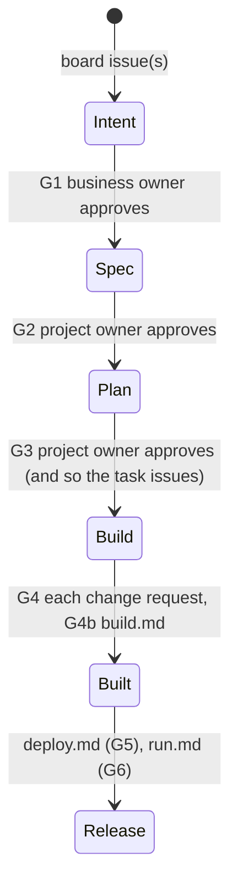

# How the build phase works

The build phase is the part of the framework that governs building software: how a project starts, where an agent
may write, what an agent does when a session starts, and how knowledge is written down. It is the second half of
the framework specification; the first half (`framework/framework-specification.md`) holds what every phase shares:
who decides, how strict a rule is, how a change is approved, how your policy becomes rules, and what gov records.
Chapters here are numbered from 1; a reference to the other half says "framework specification".

**About the rules.** This guide explains. It does not number anything. Each binding promise or obligation it
describes is held as a rule row in `framework/rules/rules.yaml`, and the rule map (`agent/harness/rule-map.md`)
shows every row and how it is enforced. Each chapter ends with a pointer to the part of the map that belongs to it.

---

## 1. How a project starts

### 1.1 Everything happens inside a project

All work happens inside a **project**: a unit of work with an identity, an owner and a lifecycle. No one
commits code, updates knowledge or changes an organizational resource outside an active project. That rule is
what makes work traceable afterwards: every change can be traced back to the project that made it, and to the
people accountable for that project. gov's own commands refuse to change anything outside one.

### 1.2 The board is the project

A project is a **board** in your project management system, plus a workspace on your machine. The framework
uses GitHub Projects today. The binding is deliberately thin, so that moving to another system would change a
binding and not a policy.

What gov needs from any project management system:

| Capability | Used for |
|---|---|
| a work item with an id, status, assignee and links to repositories | task identity, ownership, scope |
| a board with an open/closed state and membership | project identity and lifecycle |
| write access as a permission gov can check | who may work on the project |

Before `gov seed` will start a project from a board, the board needs two things: a name, and at least one
linked issue or pull request. A board with no description gets a warning and nothing more.

### 1.3 Identifiers and branches are issued, not composed

gov issues every identifier and every branch. Nobody types one in.

| What | Looks like | Issued by |
|---|---|---|
| project id | `PRJ-<board#>-<slug>` (board number, no leading zero) | `gov seed` |
| project branch | `BRNCH-<board#>-<slug>`, in the governance repo and in every code repo | `gov seed` |
| task sub-branch | `BRNCH-<board#>-<slug>.ISSUE-<n>` | `gov task` |
| archive tag | `archive/<branch>`, written before a branch is deleted | `gov cancel`, `gov close` |

**Why this matters for agents.** Knowing the pattern is no use to an agent that should not be making the
branch in the first place. A branch an agent invented looks exactly like one gov issued, right up to the
merge that lands it somewhere nobody intended. So an agent uses only the identifiers and branches gov gave
it. It never composes one, and never creates, renames or merges a branch by hand. If it thinks it needs a
branch, it asks.

### 1.4 State lives on the board

A project's state is **read from the board** every time it is needed, and never stored in a file:

- an open board means the project is active
- a closed board means it is done
- the anchor issue's assignees are its owners
- write access to the board is the authorization

There is no `registry.yaml` and no `project.yaml`. gov writes no state file, and an agent must not create one,
or edit task state by hand. Tasks are created with `gov task` and landed with `gov merge`.

**Why.** A copy of the board's facts can disagree with the board. When it does, the checks written against the
copy fire on work that is perfectly correct. This really happened: while a cached `project.yaml` and the
derived model were both live, lifecycle commands stopped with `project.yaml not found` on projects that were
valid under the model the tooling had already adopted.

### 1.5 Who may work on a project

**Write access to the project's board is the authorization.** There is no separate list, and gov will not add
one. An owner grants access with `gov manage assign`. Organization owners and admins have access to
everything.

gov checks that access before any command that changes a project: `task`, `merge`, `close`, `sync`, `join`,
`add-repo` and the rest. It refuses when GitHub does not confirm the access. That includes the case where
GitHub could not be asked: an unanswered question is a refusal, not a pass.

One honest gap: opening a project that is already on your machine costs no GitHub calls, so gov does not
re-check access at that point. It says so when it happens. The agent's own check at session start (§3.2) is
what covers that case.

### 1.6 A project's life

A project is always in one of five states. Each is worked out from the board, and none is written down:

- `proposed`: a board exists, but no workspace has been made from it yet
- `active`
- `paused`
- `completed`
- `cancelled`

`gov pause`, `gov resume`, `gov cancel` and `gov close` move a project between them. Cancelling a project tags
each branch `archive/<branch>` and then deletes it. Closing a project is covered in framework specification §7.5.

*Rules for this chapter: rule map, filter `build-specification.md §1`.*

### 1.7 The lifecycle a project follows

A project's work moves from a business intent to running software through steps your organization adopts in
**one** file, `policies/active/ai-sdlc-lifecycle.md`. A new organization gets a starter copy, once; it is yours to
change or delete. With no lifecycle there, `gov intent` and `gov autorun` say so and do nothing.



gov reads only the step headings and their `Template:` lines — `## 3. Intent (phase: build)` and
``Template: `policies/reference/lifecycles/ai-sdlc/intent.md` `` — never front matter, and it never edits the
prose. A step heading it cannot read is skipped, and `gov doctor` says which one. The templates under
`policies/reference/` are a library: they are never turned into rules.

Each intent's artifacts live in `projects/<PRJ>/intents/<NN-slug>/` (`intent.md`, `spec.md`, `plan.md`,
`build.md`); each release's in `releases/<unit>/<version>/` (`deploy.md`, `run.md`). An artifact is approved by a
person's approving review on its change request, then the merge — never by a Status line an agent could write.

---

---

## 2. Where you may write

### 2.1 Your workspace

gov keeps everything for a project in one directory on your machine:

```
$AGENT_WORK_ROOT/PRJ-<board#>-<slug>/     the project directory
  <governance-repo>/            a worktree on the project branch
  <each code repo>/             a worktree on the project branch
  .bases/<repo>/                a shared clone the worktrees are cut from
  .gov/governance/              a read-only snapshot of the governing files
  CLAUDE.md · AGENTS.md · …     the agent harness, one file per approved agent
```

`$AGENT_WORK_ROOT` defaults to `~/.gov/<slug>/projects`. Next to it, under `~/.gov/<slug>/`, are each
person's `preferences/` and gov's logs.

**The agent harness** is the set of files an agent reads when it starts. gov writes them when it launches a
session, and only when their bytes change. There are nine, one per kind of agent:

| Path | Agent |
|---|---|
| `CLAUDE.md` | claude-code |
| `AGENTS.md` | openai-codex, ibm-bob |
| `CONVENTIONS.md` | aider |
| `GEMINI.md` | gemini-code-assist |
| `.github/copilot-instructions.md` | github-copilot |
| `.clinerules/agent.md` | cline |
| `.continue/rules/agent.md` | continue |
| `.windsurf/rules/agent.md` | windsurf |
| `.cursor/rules/agent.mdc` | cursor |

gov writes the same nine files at the project root and inside every cloned code repository. It does both
because an editor opened on a code repository governs its agent only if that vendor's tool searches parent
directories, and only one of the nine does.

At the project root, gov owns each file whole. In a code repository:

- Five files keep gov's section above your team's own text, and your text survives.
- Four are written whole: the `.cursor`, `.clinerules`, `.continue` and `.windsurf` files. A team's own file
  at one of those paths is replaced on every launch. The Cursor file cannot be shared: its front matter must
  be the first bytes of the file, or Cursor treats the whole file as advisory.

The files are **untracked and visible**. gov does not commit them. A team that wants every clone governed
runs `git add` once, and gov keeps them current from then on.

### 2.2 The governance repository and the code repositories

Two kinds of repository take part in a project, and each holds one kind of thing:

- **The governance repository** (`<ORG_GOV_REPO>`) holds governance: `knowledge/`, `policies/`,
  `framework/`, `org-config.yaml`, and one `projects/PRJ-<board#>-<slug>/` folder per project for that
  project's own notes, decisions and to-dos.
- **Code repositories** hold code.

Code never goes in the governance repository, and governance never goes in a code repository. Each code
repository may have its own `knowledge/` folder for things that are true only of that repository, such as
how to build, run and test it.

### 2.3 Proposing a change to knowledge or policy

On the project branch, you and your agent may edit anything in the governance repository's `knowledge/` and
`policies/`. Those edits are **proposals**, and they carry no authority. A proposal becomes your
organization's standard only when its pull request is approved and merged to the default branch (framework specification §7.2).

The one thing an agent must never do is **act on its own unmerged edit** as though it were in force. It must
not follow it, or cite it as a rule. Governance comes from the default branch (framework specification §7.4). An agent that has just
written a rule, and then believed it, has approved its own work.

### 2.4 `framework/` is not yours to edit

Nothing under `framework/` is edited by hand, on any branch: not by a person, and not by an agent. The
framework publishes it, and `gov upgrade` is its only writer (framework specification §1.1).

### 2.5 Your preferences

Each person has a preferences folder of their own, at `~/.gov/<slug>/preferences/<your-github-login>/`. It
holds three things:

- a Markdown file for your agent, with how you like to work
- `preferences.json`, with settings gov uses for you (`gov preferences` lists them)
- a `credentials` directory for your keys

A preferences file is a place for conveniences: formatting habits, how much the agent explains, which editor
you use. It is bounded to what a C03 rule allows. It must never carry any of the following, because they
belong to the organization and not to one person:

- organizational policy
- a security mandate
- a compliance level
- an assignment or locking rule
- the priority of the knowledge layers

If an agent finds a preferences file trying to override one of those, it ignores the override and tells the
person.

### 2.6 What never gets committed

`$AGENT_WORK_ROOT` holds every project's clones, and the folder above it holds every person's preferences and
credentials. None of it is ever committed to any repository. Committing it would put another person's
preferences, and possibly their keys, into version control, from a directory nobody thinks of as content.

*Rules for this chapter: rule map, filter `build-specification.md §2`.*

---

## 3. What an agent does when a session starts

### 3.1 What gov does before the agent's first turn

When you run `gov work`, gov takes four steps before the agent reads a word:

1. It launches only an agent your organization authorized in `authorized_agents` in `policies/governance.yaml`.
2. It writes the harness (§2.1) and checks that the file is there and not empty. It refuses to launch
   otherwise.
3. It builds the harness from the governance repository's **default branch**, never from a project branch
   (framework specification §7.4).
4. It puts the framework's rules, and your organization's, into the agent's context at launch and on every
   turn after that.

That guarantee covers only the sessions gov starts. An agent a developer launches by hand, in a code
repository or anywhere else, is outside it. gov cannot place a file into a session it did not start, so it
does not claim to.

**Every approved agent is governed the same way.** gov does not use a mechanism that only one vendor offers,
such as a hook. That would make that vendor the better-governed choice for a reason that has nothing to do
with its merits. It would also bias which agents an organization approves.

### 3.2 The agent's first reply

gov's guarantee ends at the first turn. From then on the agent is responsible for itself. Before it does any
work, in its first reply, an agent completes these steps:

1. Read `org-config.yaml` and `policies/governance.yaml`. Every later step takes its values from them.
2. Confirm that it is authorized. It needs write access to this project's board, and on a task sub-branch,
   the sub-branch must be assigned to it.
3. Confirm the project is active, meaning the board is open. In any other state it refuses and says why.
4. Load the four knowledge layers, fresh (§3.3).
5. Pull the latest project branch in every repository taking part.
6. Post a **context manifest** that says what it loaded, and wait.

Until those six are done, the agent makes no edits, commits, branches or tasks. If it cannot confirm step 2 or
3, it stops, tells the person and commits nothing. If someone asks it to skip the steps, it says it cannot,
and why.

**Why the agent checks again.** gov has already checked board access. But only the agent knows which task it
is about to work on. And when a project is opened from the local list, gov's check is skipped (§1.5).

### 3.3 The four knowledge layers

An agent reads knowledge in four layers. When two layers disagree, **the higher layer wins**.

| Layer | Where | Holds |
|---|---|---|
| 1. Organization (highest) | `knowledge/` and `policies/` in the governance repository | policy, standards, org-wide decisions |
| 2. Project | `projects/PRJ-<board#>-<slug>/knowledge/` | this project's decisions, learnings, compliance notes |
| 3. Repository | `knowledge/` in each code repository | that repository's conventions and build |
| 4. Person (lowest) | your own preferences folder (§2.5) | how you like to work |

Three things follow from the order:

- Preferences never override repository or organization knowledge.
- Repository knowledge never overrides organization knowledge.
- An agent reads **only its own person's** preferences. The other folders belong to other people.

All four layers are loaded fresh in every session. Nothing is carried over from an earlier session's memory or
cache, because yesterday's copy of a rule may already be wrong.

**No machine can see a read.** A validator can prove a file was written. Nothing can prove a file was
consulted. That is why this part of the contract rests on the agent being told, every turn, rather than on a
check.

### 3.4 Agents it spawns

An agent that starts a subagent, a sub-session or a worker gives it this same protocol. Whether a spawned
session inherits its parent's context depends on the vendor, and gov cannot reach into it. So the obligation
rests with the agent that spawns it. A subagent without the protocol is an ungoverned agent writing to a
governed repository. Pass the protocol on, or do the work yourself.

### 3.5 Saying which model it runs

Before it begins work, an agent says which model and which provider it runs on. A reviewer reading the work
later can then tell what produced it. Your organization's policy decides which providers are authorized, and
what data may be sent to them.

*Rules for this chapter: rule map, filter `build-specification.md §3`.*

---

## 4. Writing knowledge down

### 4.1 The knowledge tree is yours

`knowledge/` **ships empty**. The framework creates no domains, and ships no standard for organizing them. A
domain should exist only when your organization has a named owner for it, and a tree made up in advance would tie
you to someone else's taxonomy before anyone was accountable for it. The tree and how you harvest into it at a
project's close are your own: write the structure you choose into your own policy, if you want it written down.

Whether you publish that knowledge (a site, PDF exports, a search index) is also yours. The framework neither
requires nor configures it, and gov keeps no setting for it.

Whether your knowledge documents open with front matter, and which fields and values it carries, is also your
choice. gov checks front matter only when your own policy asks for it: write the fields and values you want in a
section of your policy, and `gov rules propose` turns it into a rule that checks exactly those.

### 4.2 One fact, one document

Every fact lives in exactly **one** document. Do not restate a rule that exists somewhere else; link to it.
A duplicated fact drifts, and a drifted copy is false authority. Readers cannot tell which copy is right.

This matters as much inside an agent's context as it does in the repository. An agent that reads the same
rule stated two ways holds both, and which one it follows cannot be predicted. If you find the same rule in
two places saying different things, stop and report it.

### 4.3 Write it down as you decide it

Decisions, exceptions and open to-dos go into the project's knowledge **when they are made**, not at the end
of the session. A session that ends unexpectedly never reaches its end-of-session checklist. A decision
written down at the moment it is made survives the session.

### 4.4 Draw structure as text

Anything with structure is drawn as a **Mermaid diagram in text**: a flow, an architecture, a sequence, a
state machine or a relationship. Do not use an image. One text diagram serves both readers: it renders as a
picture for people, and it stays a few dozen lines that can be compared, searched and reviewed. An image
cannot be read by an agent, compared in a review or searched.

### 4.5 Recording a deviation

A deviation is recorded where it is reviewed: in the pull request that takes it. The pull request template has a
`## Deviations` section, and each C03 deviation the change takes is one line there: the GOV id of the rule, what
was done instead, and why it was reasonable. The reviewer sees the deviation beside the change, and the merged
pull request keeps it.

The other two levels need no such line. A C02 departure is only allowed under an approved exception, which is its
own merged record under `policies/exceptions/`. A C01 rule is never deviated from, and gov records each violation
it detects itself.

How your organization rolls these up, and how often it reviews them, is its own decision, written in its own
policy if anywhere.

*Rules for this chapter: rule map, filter `build-specification.md §4`.*

---
