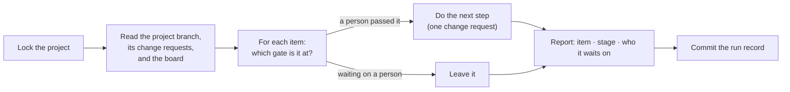

# Running the lifecycle

`gov autorun` does the drafting between the lifecycle's gates. People approve, and gov drafts the next step. Each
run moves every item whose gate a person has passed forward by one step, then stops and tells you who each item
is waiting on. Run it again after the next approval.

It needs an adopted lifecycle (`policies/active/ai-sdlc-lifecycle.md`). Without one, it says so and does
nothing. [Working on a project](working-on-a-project.md) explains intents (§4) and how a gate is passed (§5).

## The gates

An agent drafts each artifact and a person approves it. Approval is a person's approving review on the
artifact's change request, followed by the merge. gov reads that from the code host. It never reads it from text
an agent could have written.

| Gate | What is approved | Who approves (starter policy) | What autorun drafted before it |
|---|---|---|---|
| G1 | `intent.md`, after the owner interview | the business owner | the intent, from a board issue |
| G2 | `spec.md` | the project owner | the spec, from the approved intent |
| G3 | `plan.md` (tasks, test plan, documentation plan) | the project owner | the plan, from the approved spec |
| G4 | each task's change request | the code owner | — (not yet: see below) |
| G4b | `build.md` | the project owner | the build record, once every task's change request is merged |

Your organization decides who approves each gate in the Gates section of its lifecycle policy.

## What one run does



What it does for each item:

| It finds | It does | Then the item waits at |
|---|---|---|
| a board issue in no intent | drafts an intent from it, as `gov intent` does: a tracking issue, `intent.md` (DRAFT), a change request | G1 |
| an approved intent, no spec | an agent drafts `spec.md` | G2 |
| an approved spec, no plan (or a stale plan) | an agent drafts `plan.md` | G3 |
| an approved plan whose task issues do not exist yet | creates one issue per task in the plan, assigned to the person who approved the plan, each linking to the plan's change request | — (the next run continues) |
| a task issue with no change request | **not done yet:** the item is reported as failed. Start the task with `gov task` | G4 |
| every task's change request merged, no `build.md` | an agent drafts `build.md` | G4b |
| an open change request for one of its artifacts | nothing — it waits for the review | the same gate |
| a spec that changed after its plan was approved | marks the plan STALE, by change request | G2, then G3 |

A **board issue in no intent** is an open issue on the project's board, in Todo or with no status, with no
`gov-…` label. gov's own issues (intent tracking issues, signals, task issues and the project's anchor) are never
drafted into intents, and neither is an issue already in progress.

How an agent's draft reaches you:

- The agent works in a separate checkout on its own branch, `<project-branch>.INTENT-<NN>-<artifact>`, so your
  checkout is not touched.
- Its instructions are the same session-start prompt `gov work` gives an interactive agent, followed by a brief.
  The brief names the file to write, the lifecycle step skill (`gov-lifecycle-spec`, for example) and the
  template.
- gov, not the agent, commits the draft. Whatever Status the agent wrote, the file says `DRAFT`. The commit
  carries two trailers: `Gov-Autorun: <run id>` and `Gov-Agent: <agent>`. That is how you can count what autorun
  produced.
- gov pushes the branch and opens a change request to the project branch. The request traces to the intent's
  tracking issue.

**Try it first with `--dry-run`.** It prints what each item would do next and changes nothing.

```bash
gov autorun --dry-run          # what would happen
gov autorun                    # every item
gov autorun --intent 03        # one intent only (board issues in no intent are left alone)
```

Run it from the project, on the project branch, with no uncommitted changes. If the project branch is behind its
copy on the host, gov brings it up to date first. If the two have diverged, it stops and asks you to pull.

## Which agent drafts

autorun runs an agent with nobody at the terminal. It uses an agent only when both of these are true:

- your organization approved it (`authorized_agents` in `policies/governance.yaml`), and
- gov has seen that agent's command line run without a terminal. See
  [Which agents can run headless](configuring-agent-harnesses.md#which-agents-can-run-headless). Today that is
  Claude Code.

`--agent <id>` names the agent. If it names one that is not approved or cannot run headless, gov refuses the run
and says why. Without `--agent`, gov uses your organization's default agent if it can run headless, otherwise the
first approved agent that can. If none can, the steps that need no agent still run: drafting intents, creating
task issues and marking plans stale. The drafting steps fail, and the report says why.

gov never adds permission-bypass flags. What the agent may do comes from its own settings in the project, which
your organization controls.

## Budgets

One run has limits. They are set in `policies/governance.yaml`:

```yaml
autorun:
  item_minutes: 30   # how long one item's agent may run before it is stopped
  run_items: 10      # how many items one run starts
  run_crs: 10        # how many change requests one run opens
```

These are your organization's ceilings. `--max-minutes <n>` can lower the time limit for one run, but never raise
it. An agent that runs past its time is stopped and that item is reported as failed. When a run reaches its item
or change-request limit, the remaining items are reported as "not started" and wait for the next run. A value in
the file that is not a positive whole number is reported, and the default (shown above) is used instead.

## What it never does

- It never merges, closes an issue or a board, or sends a signal. Those are people's acts.
- It never approves anything. An agent's draft is always `DRAFT`.
- It never opens a change request to anything but the project branch.
- It runs one item at a time. `--parallel` with more than one is refused for now.

## Stopping it

- **A C01 rule stops the whole run.** This happens when the agent exits naming a C01 rule, or when a gate (for
  example a commit hook) refuses gov's commit with one. Nothing is committed or pushed for that item, the items
  after it are not started, and gov exits 2. Fix what the rule is about, then run again.
- **Any other failure stops only that item.** This covers an agent error, the time limit, or an agent that
  wrote nothing or committed by itself. That item is reported as failed, the others continue, and gov exits 1.
  Nothing is left behind for the failed item.
- **One run per project.** A second `gov autorun` on the same project, while one is running, is refused. The
  lock is a file under your gov state folder (`preferences/<you>/state/autorun/`).
- **Interrupting a run (Ctrl-C).** The lock file stays behind. The next run names it. Once the lock is older than
  the run's budget, gov reports it as stale but never removes it by itself. If no run is going, delete the file
  it names. A draft the agent was still writing is left in a checkout under `state/autorun/worktrees/`. Remove
  it with `git worktree prune` after deleting the folder.
- **Keeping autorun away from an item.** Do not approve it: autorun only moves items whose gate a person has
  passed. To work on a single intent, use `--intent <NN>`.

## Reading what it did

Every item gets one line in the terminal:

```
autorun 2026-10-13-0800-a1b2 · PRJ-7-alpha
  01-alpha     intent  → draft-spec done (https://github.com/acme/acme-gov/pull/101); ✋ now waiting on the project owner (spec approval)
  02-beta      intent  ✗ failed: the agent exited 4: tests failed
  04-delta     spec    ✋ waiting on the project owner (plan approval) — review https://github.com/acme/acme-gov/pull/12
  app#42       intake  → draft-intent done (https://github.com/acme/acme-gov/pull/102); ✋ now waiting on the business owner (intent interview + approval)
recorded: projects/PRJ-7-alpha/autorun/2026-10-13-0800.md
```

gov saves the same report as the run record, `projects/<PRJ>/autorun/<yyyy-mm-dd-hhmm>.md`, and adds one line to
the project's `knowledge/decisions.md`. Both are committed on the project branch and pushed. If the push is
refused, the report says the record is committed but not pushed. Two runs in the same minute get two files
(`…-2.md`).

| Exit | Means |
|---|---|
| 0 | every item that could move did |
| 1 | an item failed (the others ran), the run record could not be committed, another run holds the lock, or you are not authorized |
| 2 | a C01 rule stopped the run, or a usage error |
