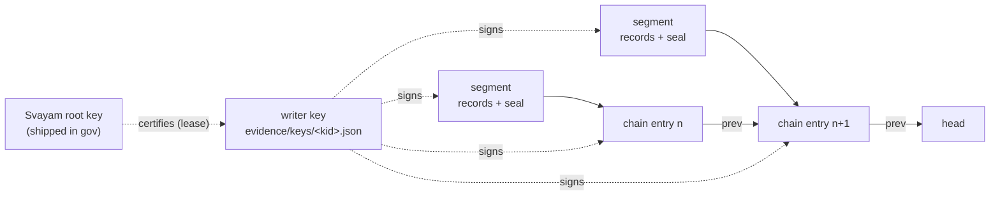

# Evidence and auditor reports

gov runs your organization's checks for free. With a subscription, it can also keep a **signed record** of every
check, gate decision and governed session. That record is the evidence an auditor asks for. It lives in your own
governance repository, on a branch called `gov/evidence`, and never leaves your environment.

Checking that record is free. You do not need a subscription, a licence or a network connection to verify it.

---

## Turning evidence on for yourself

Your organization's admin turns evidence on for the organization. Each person who wants evidence written from
their own machine then does three things, once per machine:

1. **Generate a personal key** in the Svayam portal, under Account → Keys.
2. **Sign in:** `gov licence login`, and paste the key. It goes into your OS keychain (macOS keychain, the Secret
   Service on Linux, Windows Credential Manager). It is never written to a file and never shown. On a machine
   without a keychain, put it in the `GOV_LICENCE_KEY` environment variable instead.
3. **Install the module:** `gov licence install`. gov swaps your key for a registry token that lasts about 15
   minutes and installs `@svayam/gov-check` with it. The token is never saved.

Check it with `gov licence status`:

```text
gov licence status
  personal key   stored in macOS keychain
  gov-check      installed (licence-install)
  state          licensed
  org            github 297356872
  plan           pilot
  entitlements   evidence
  lease expires  2026-10-20T08:00:00Z
```

**What leaves your machine.** Only your personal key (to get a lease or a registry token), your writer's public
key, and counts — never a record, a repository name, a rule or a verdict. CI does not use a personal key: the
workflow proves who it is with GitHub's own token.

---

## Verifying evidence

This section is for **auditors**, and for organizations whose subscription has ended but who still need to show
old evidence. `gov evidence verify` checks that nothing in the record was changed, removed, reordered or added
after it was written.

### What you need

- gov installed (`npm install -g @svayam-opensource/gov`).
- A copy of the evidence branch. Either clone it on its own:

  ```bash
  git clone --branch gov/evidence --single-branch https://github.com/<org>/<gov-repo>.git acme-evidence
  gov evidence verify --gov-home acme-evidence
  ```

  or, inside the organization's governance repository, fetch it and run the command there:

  ```bash
  git fetch origin gov/evidence
  gov evidence verify
  ```

To check one audit period, give the dates. The whole chain is still followed from its start, because every link
is needed, but only the records dated in the period are re-read:

```bash
gov evidence verify --from 2026-07-01 --to 2026-09-30
```

### What it checks



- **The chain.** Entries are numbered 1, 2, 3 … across monthly files in `evidence/chain/`. Each entry holds the
  hash of the entry before it, so a deleted, moved or replaced entry breaks the next link. The first entry of a
  month links to the last entry of the month before.
- **The segments.** Each entry names one segment file and its hash. A changed or deleted segment no longer
  matches. Inside the segment, the last line (the seal) holds the number of records and one hash over all of
  them, so a changed, added or removed record is caught.
- **The signatures.** Every seal and every chain entry is signed by the key that wrote it.
- **The writers.** A writer's key counts only if a lease from a Svayam root key vouches for it. The root keys
  ship inside gov. A newer root listed in `evidence/keys/roots.json` is trusted only if an older, trusted root
  has signed it.

### Reading the result

A clean ledger ends with `verified` and exits 0. Any problem exits 1 and names where it is:

```text
  BROKEN    2 breaks:
    evidence/2026/10/30/ci-77-9123-1.jsonl line 4: the root does not match records 1–3 — a record line was changed
    evidence/chain/2026-10.jsonl entry 1 (line 1): sha256 of evidence/2026/10/30/ci-77-9123-1.jsonl does not match — the segment was changed after it was chained
NOT VERIFIED — 2 breaks; the first: …
```

When a changed record still reads as a valid record, gov cannot tell which line inside the segment changed. The
seal holds one hash for the whole segment. In that case the break names the segment's seal line. Use
`git log -p -- <segment>` on the evidence branch to see the change itself.

### Gaps

A **gap** is a run for which no evidence was written, for example because a licence had lapsed. Gaps are kept in
files named `gap-….jsonl`. They are listed in the output with the run and the reason. They are **never** counted
as verified evidence, and a gap file that holds anything other than a gap is reported as a break.

### Test ledgers

A ledger written while testing is certified by a **test** root key (its name starts with `test-`). gov does not
trust test roots unless you pass `--test-roots`, and then it says so in the output. Never accept a test ledger
as audit evidence.
