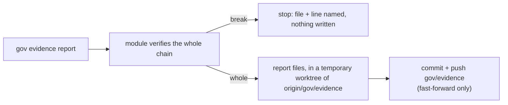
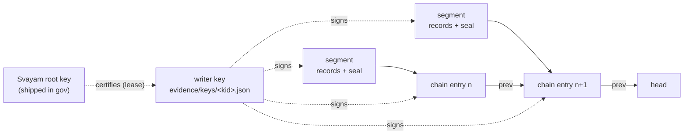

# Evidence and auditor reports

gov runs your organization's checks for free. With a subscription, it can also keep a **signed record** of every
check, gate decision and governed session. That record is the evidence an auditor asks for. It lives in your own
governance repository, on a branch called `gov/evidence`, and never leaves your environment.

Checking that record is free. You do not need a subscription, a licence or a network connection to verify it.

---

## Turning evidence on for your organization

An owner of the GitHub organization does this once, in the governance repository:

```bash
gov evidence enable
```

It does three things. Each one that is already done is skipped, so running it again changes nothing.

1. **The evidence branch.** It creates `gov/evidence` in the governance repository, with a README and
   `evidence/keys/roots.json`. The branch has no shared history with your default branch, which is never touched.
2. **The branch rules.** It adds a ruleset named "gov evidence" that refuses force pushes and deletion on that branch
   for everyone, admins included. Writers can still add to it. Rulesets on a private repository need GitHub Team or
   Enterprise; on another plan the command says so.
3. **The writer App.** It creates your organization's own GitHub App, "&lt;org&gt; gov evidence", which may write
   repository contents and nothing else. Svayam never gets write access to your repositories. gov prints a local
   page: open it in a browser on the same machine and confirm on GitHub. gov stores the App's client id and
   private key as the organization secrets `GOV_EVIDENCE_APP_CLIENT_ID` and `GOV_EVIDENCE_APP_PRIVATE_KEY`, and
   keeps no copy of the key.

Then **install the App** on the governance repository only. The command prints the link: choose your organization,
then "Only select repositories" and pick the governance repository.

On GitHub Free, an organization secret does not reach a private repository. Give each private code repository its
own copy of both secrets.

---

## Evidence from CI

Once an organization has turned evidence on, its code repositories' `gov-checks` workflow writes signed evidence
without anyone logging in. Re-render the workflow (`gov check install`) to pick the steps up. Each run then:

1. asks GitHub for the job's identity token, for the audience `gov-evidence`;
2. swaps it at Svayam's licence service for a registry key that lasts about 15 minutes;
3. installs `@svayam/gov-check` with that key;
4. mints the evidence App's token, and runs your checks, which write one signed segment to the `gov/evidence`
   branch of your governance repo.

Nothing licence-related is stored as a secret: the only secrets are the two GitHub Apps' (the one that reads your
governance repo, and the evidence App). The job sends the licence service only that identity token, a throwaway
public key and a few usage numbers. It never sends rule ids, commit ids, repository names or any record.

If your organization has no subscription, the licence service says no, and the run prints one notice. Your checks run
and judge exactly as before. If the service is unreachable, the run says nothing and carries on. If you have not
turned evidence on, these steps are skipped and nothing leaves your environment.

## Turning evidence on for yourself

Your organization's admin turns evidence on for the organization. Each person who wants evidence written from
their own machine then does three things, once per machine:

1. **Generate a personal key** in the Svayam portal, under Account → Keys.
2. **Sign in:** `gov licence login`, and paste the key. It goes into your OS keychain (macOS keychain, the Secret
   Service on Linux, Windows Credential Manager). It is never written to a file and never shown. On a machine
   without a keychain, put it in the `GOV_LICENCE_KEY` environment variable instead.
3. **Install the module:** `gov licence install`. gov swaps your key for a registry token that lasts about 15
   minutes and installs `@svayam/gov-check` with it. The token is never saved.

Check it with `gov licence status`:

```text
gov licence status
  personal key   stored in macOS keychain
  gov-check      installed (licence-install)
  state          licensed
  org            github 297356872
  plan           pilot
  entitlements   evidence
  lease expires  2026-10-20T08:00:00Z
```

**What leaves your machine.** Only your personal key (to get a lease or a registry token), your writer's public
key, and counts — never a record, a repository name, a rule or a verdict. CI does not use a personal key: the
workflow proves who it is with GitHub's own token.

---

## Running an auditor report

With the gov-check module installed (see above), `gov evidence report` turns the ledger into a report an auditor can
read. Run it in the governance repository:

```bash
gov evidence report --pack soc2-cc8 --from 2026-07-01 --to 2026-09-30
```

| Flag | Meaning |
|---|---|
| `--pack <id>` | The compliance pack to report on. `gov pack list` shows them. Required. |
| `--from`, `--to` | The audit window, both days included, as `YYYY-MM-DD`. Required. |
| `--repo <name>` | Only changes in this code repository. |
| `--format md\|json\|html` | The readable file to write. The default is `md`. `report.json` and `manifest.json` are always written. |
| `--gov-home <path>` | The governance repository, or a clone of `gov/evidence`, if you are not inside it. |



The files land on the evidence branch under `evidence/reports/<pack>/<from>_<to>/`: `report.md` (or the format you
asked for), `report.json`, and `manifest.json`. gov builds them in a temporary copy of `origin/gov/evidence`, commits
them there, pushes only a fast-forward, and removes the copy. Your own checkout and your default branch are never
touched, and nothing is sent to Svayam. Running the same report again over the same ledger gives the same bytes, so
there is nothing new to commit and gov says so.

If the chain is broken, the report stops at the first break, prints the file and line, exits 1 and writes nothing.
Fix or explain the break first: `gov evidence verify` shows all of them. Without the module, `gov evidence report`
prints one line pointing at the subscription and exits 1.

---

## Reading a report with an auditor

A report is organised by **control** (for example "changes are authorised before they are made"), not by rule. An
auditor asks about controls, so each one answers the same questions:

- **How many changes** the control covered (the population: pull requests, or commits where there is no pull request).
- **What happened to them:** counts of pass, fail, cannot-tell and needs-subscription. An LLM judge's opinion is
  counted separately; it is shown but never enforces.
- **Exceptions:** the approved exceptions in `policies/exceptions/` that name the control's rules.
- **Gaps:** runs for which no evidence was created. A gap is shown **as a gap**. It is never counted as a pass, and an
  auditor should ask about each one.
- **Agent or human:** how many of the changes were made by each.
- **A sample:** up to 25 records per control, each naming its segment and line so the auditor can open the record and
  check it. The sample is picked by a hash of the window and the record, so the same ledger always gives the same
  sample and nobody can choose it.

Every report carries a **"mapping not audited"** label until the pack's control mapping has been signed off by a
compliance reviewer. The label means that gov has not yet confirmed that these checks satisfy the control: the report
shows what was checked and what happened, not that the control is met. Treat the mapping as a starting point for the
conversation with your auditor.

To let the auditor check the report themselves, give them a clone of `gov/evidence` and have them run
`gov evidence verify`. `manifest.json` records the chain head, the verification result and the hash of every input and
every file, so they can see that the report was made from the same ledger they verified.

---

## Verifying evidence

This section is for **auditors**, and for organizations whose subscription has ended but who still need to show
old evidence. `gov evidence verify` checks that nothing in the record was changed, removed, reordered or added
after it was written.

### What you need

- gov installed (`npm install -g @svayam-opensource/gov`).
- A copy of the evidence branch. Either clone it on its own:

  ```bash
  git clone --branch gov/evidence --single-branch https://github.com/<org>/<gov-repo>.git acme-evidence
  gov evidence verify --gov-home acme-evidence
  ```

  or, inside the organization's governance repository, fetch it and run the command there:

  ```bash
  git fetch origin gov/evidence
  gov evidence verify
  ```

To check one audit period, give the dates. The whole chain is still followed from its start, because every link
is needed, but only the records dated in the period are re-read:

```bash
gov evidence verify --from 2026-07-01 --to 2026-09-30
```

### What it checks



- **The chain.** Entries are numbered 1, 2, 3 … across monthly files in `evidence/chain/`. Each entry holds the
  hash of the entry before it, so a deleted, moved or replaced entry breaks the next link. The first entry of a
  month links to the last entry of the month before.
- **The segments.** Each entry names one segment file and its hash. A changed or deleted segment no longer
  matches. Inside the segment, the last line (the seal) holds the number of records and one hash over all of
  them, so a changed, added or removed record is caught.
- **The signatures.** Every seal and every chain entry is signed by the key that wrote it.
- **The writers.** A writer's key counts only if a lease from a Svayam root key vouches for it. The root keys
  ship inside gov. A newer root listed in `evidence/keys/roots.json` is trusted only if an older, trusted root
  has signed it.

### Reading the result

A clean ledger ends with `verified` and exits 0. Any problem exits 1 and names where it is:

```text
  BROKEN    2 breaks:
    evidence/2026/10/30/ci-77-9123-1.jsonl line 4: the root does not match records 1–3 — a record line was changed
    evidence/chain/2026-10.jsonl entry 1 (line 1): sha256 of evidence/2026/10/30/ci-77-9123-1.jsonl does not match — the segment was changed after it was chained
NOT VERIFIED — 2 breaks; the first: …
```

When a changed record still reads as a valid record, gov cannot tell which line inside the segment changed. The
seal holds one hash for the whole segment. In that case the break names the segment's seal line. Use
`git log -p -- <segment>` on the evidence branch to see the change itself.

### Gaps

A **gap** is a run for which no evidence was written, for example because a licence had lapsed. Gaps are kept in
files named `gap-….jsonl`. They are listed in the output with the run and the reason. They are **never** counted
as verified evidence, and a gap file that holds anything other than a gap is reported as a break.

### Test ledgers

A ledger written while testing is certified by a **test** root key (its name starts with `test-`). gov does not
trust test roots unless you pass `--test-roots`, and then it says so in the output. Never accept a test ledger
as audit evidence.
